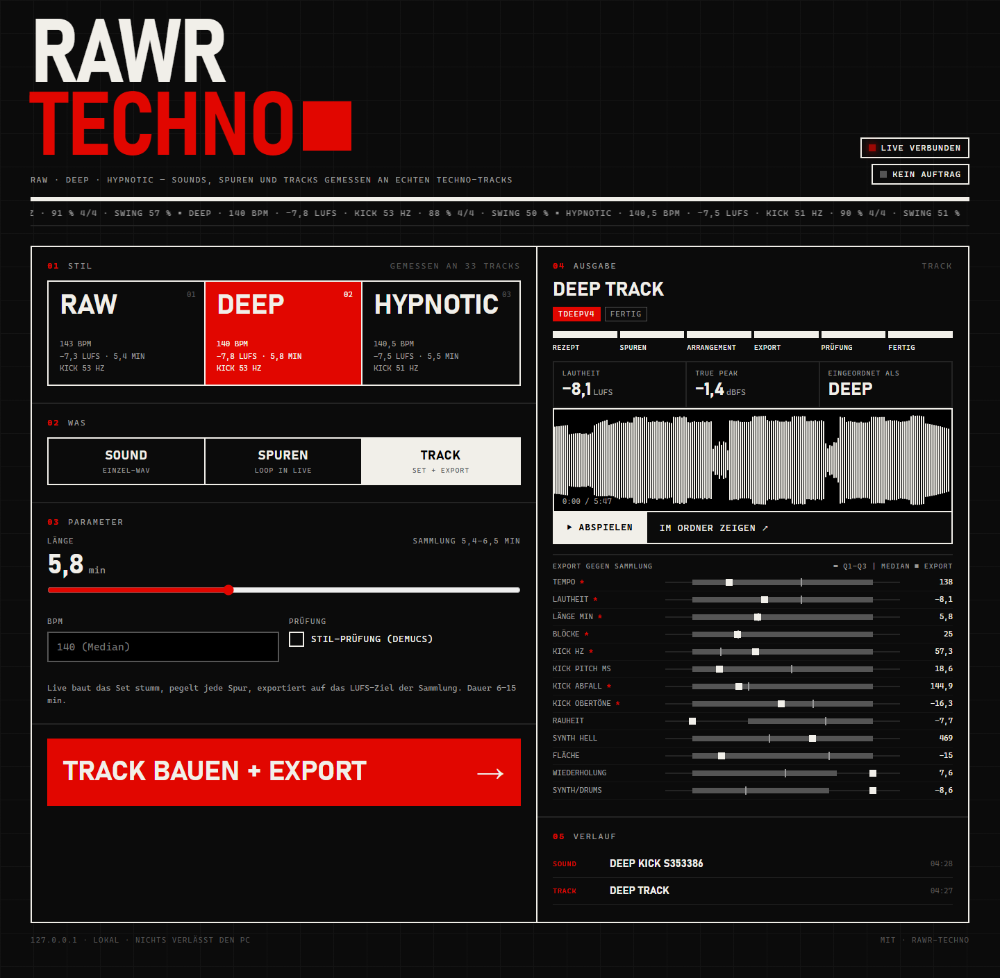
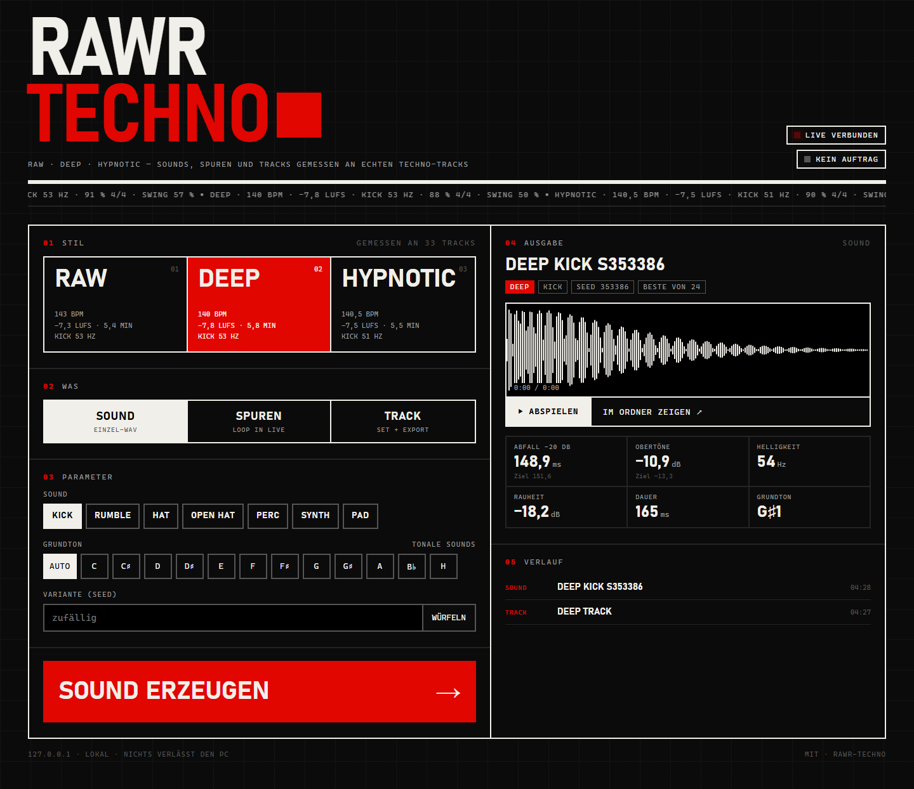

# RAWR Techno

Claude-Code-Plugin für Ableton Live: Einzelsounds, Spuren und ganze Tracks im Stil **raw**, **deep** oder **hypnotic**. Die Stile sind Kennzahlen aus einer vermessenen Sammlung von rund 230 Techno-Tracks (Tempo, Kick-Tonhöhe und -Abfall, Drum-Gerüst, Bass-Platz, Arrangement, Lautheit). Das Paket enthält nur diese Zahlen, keine Tracks, Samples oder Titel.

*Claude Code plugin for Ableton Live: generate techno sounds, parts and full tracks (raw / deep / hypnotic) from measured style profiles.*



## Was es kann

| Sag zu Claude | Ergebnis |
|---|---|
| „raw kick“, „deep pad in F“, „hypnotic hihat“ | WAV-Datei, die beste von 24 Synthese-Varianten nach Abstand zum Stil-Profil |
| „hypnotic Kick und Rumble, 16 Takte“ | Spuren als Loop im offenen Live-Set |
| „raw track“, „deep track mit 7 Minuten“ | neues Set mit Arrangement, Pegeln, Limiter auf das LUFS-Ziel des Stils und WAV-Export |
| „raw track und prüf ihn“ | dazu die Demucs-Messung des Exports gegen das Profil |
| „öffne techno“ | die Oberfläche im Browser, alles per Klick |

## Oberfläche

„öffne techno“ in Claude Code startet die App unter `http://127.0.0.1:4141` (ohne Claude: `node <Plugin-Ordner>/ableton/app-server.mjs --oeffnen`). Stil wählen, Sound, Spuren oder Track, Länge und Tempo einstellen, starten. Die App zeigt Wellenform und Messwerte, spielt das Ergebnis ab und öffnet den Ordner. Beim Track sieht man jeden Schritt (Rezept, Spuren, Arrangement, Export, Prüfung) und am Ende den Export gegen die Sammlung: graues Band = mittlere Hälfte der Sammlung, Strich = Median, Quadrat = dein Track.

Die App läuft nur auf diesem Rechner und nimmt keine Anfragen anderer Webseiten an.



## Installieren (etwa 10 Minuten)

Du brauchst Windows 10 oder 11, Ableton Live 11 oder 12 mit **deutscher Oberfläche** und [Claude Code](https://claude.com/claude-code) mit Anmeldung. Live muss über den Windows-Ausgang spielen (Einstellungen → Audio → Treiber „MME/DirectX“ oder „WASAPI“), mit ASIO kann das Plugin die Pegel nicht messen.

**1. Node.js und Python, falls noch nicht da** (PowerShell):

```
winget install OpenJS.NodeJS.LTS
winget install Python.Python.3.12
```

Danach ein neues Terminal öffnen. `python --version` muss 3.11 oder neuer zeigen. Öffnet sich stattdessen der Microsoft Store: Einstellungen → Apps → Erweiterte App-Einstellungen → App-Ausführungsaliase → „python.exe“ ausschalten.

**2. Plugin holen:**

```
claude plugin marketplace add xstaudi/rawr-techno
claude plugin install techno@rawr-techno
```

**3. In Claude Code sagen:** „richte techno ein“

Claude kopiert das Remote Script `ClaudeMixer` in deine Ableton User Library, installiert numpy, scipy, pycaw und ffmpeg, wenn sie fehlen, und meldet jede Zeile. Wurde ffmpeg neu installiert: Claude Code einmal schließen und neu öffnen.

**4. In Live einmal:** Live neu starten (erst dann kennt es ClaudeMixer), dann Einstellungen → Link/Tempo/MIDI → Control Surface → `ClaudeMixer` (Eingang und Ausgang leer lassen). Noch einmal „richte techno ein“, bis „bereit“ dasteht.

Optional für die Stil-Prüfung: `python -m pip install --user demucs` (mit Nvidia-Karte schneller).

## Aktualisieren und entfernen

```
claude plugin marketplace update rawr-techno
claude plugin update techno@rawr-techno
claude plugin uninstall techno@rawr-techno
```

Das Remote Script liegt danach noch unter `Dokumente/Ableton/User Library/Remote Scripts/ClaudeMixer` und kann dort gelöscht werden.

## Wenn etwas hakt

| Meldung | Abhilfe |
|---|---|
| „keine Antwort von Ableton“ | Live läuft nicht oder ClaudeMixer ist nicht als Control Surface gewählt (Schritt 4) |
| „Offenes Set hat ungespeicherte Änderungen“ | Set in Live speichern, dann den Track neu anfordern |
| „Python 3 fehlt“ | Schritt 1, danach Terminal und Claude Code neu starten; anderes Python per `TECHNO_PYTHON` |
| „Keine Pegel messbar“ | Live spielt über ASIO: Treiber auf MME/DirectX oder WASAPI stellen |
| „Auftrag … läuft noch“ | Es läuft immer nur ein Bau; warten, bis `status` „fertig“ meldet |
| Export hängt | während des Laufs nicht in Live klicken; Live-Oberfläche muss deutsch sein |
| Live bleibt stumm | „richte techno ein“ hebt die Stummschaltung nach einem abgebrochenen Lauf auf |

## Einstellungen (Umgebungsvariablen)

| Variable | Zweck |
|---|---|
| `TECHNO_PYTHON` | Python mit numpy/scipy, Standard `python` |
| `TECHNO_LIBRARY` | eigene Sample-Library für die Quelle `library` (Ordner `Kicks/One-Shots`, `HiHats/One-Shots`, `Percussion/One-Shots`, `Synths/One-Shots`, `Atmo-Pads/One-Shots`) |
| `TECHNO_PROFILE` | eigener Profil-Ordner (`_profil-raw.json` …) statt der mitgelieferten |
| `ABLETON_USER_LIBRARY` | nur nötig, wenn das Plugin die User Library nicht selbst findet (es liest sie aus den Live-Einstellungen) |

Setzen in PowerShell, z. B. `setx TECHNO_PYTHON "C:\Python312\python.exe"`, danach Claude Code neu starten.

## Grenzen

- Export und Speichern laufen über Tastatur und Fenstertitel von Live. Während eines Laufs nicht in Live klicken. Getestet nur mit deutscher Live-Oberfläche.
- Das Remote Script nimmt Befehle von jedem Programm auf diesem Rechner an (nur 127.0.0.1, nicht aus dem Netz).
- Die Klänge sind einfache Synthese, keine Sample-Packs.
- Live Intro erlaubt 16 Spuren; ein Track braucht bis zu 7.

## In English

Windows 10/11, Ableton Live 11 or 12 (tested: Live 11 Intro with **German UI**; English dialog titles are untested), Claude Code, Node.js, Python ≥ 3.11. Live must use MME/DirectX or WASAPI, not ASIO.

```
claude plugin marketplace add xstaudi/rawr-techno
claude plugin install techno@rawr-techno
```

Then tell Claude „set up techno“, select the control surface `ClaudeMixer` in Live, and say „raw kick“, „hypnotic kick and rumble, 16 bars“, „deep track“ or „open techno“ for the browser app.

## Lizenz

MIT, siehe `LICENSE`. Klänge und Tracks, die du mit dem Plugin erzeugst, gehören dir.
